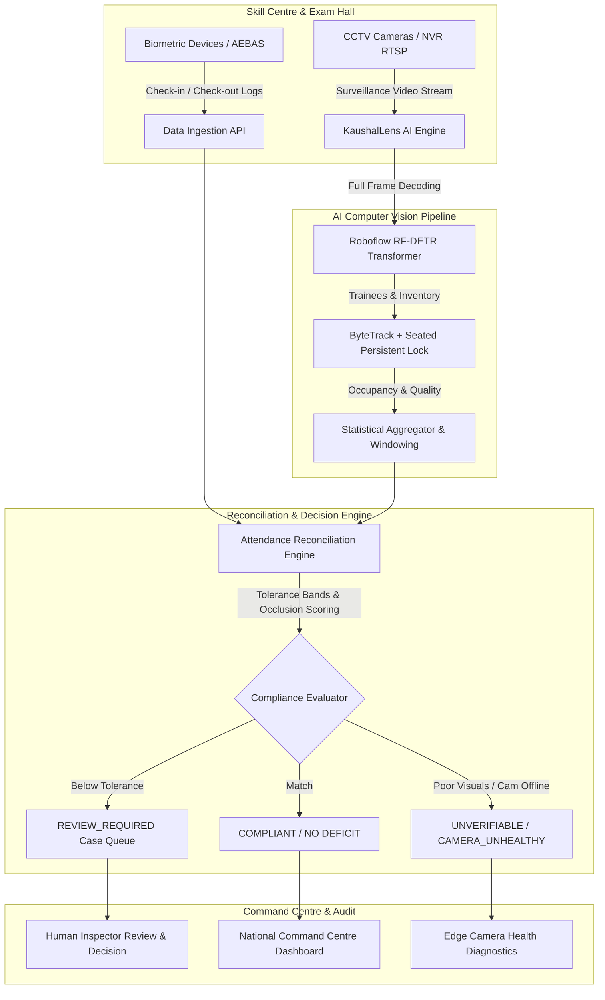

# KaushalLens (SkillGuard AI) — Comprehensive Project & Architecture Report

> **Empowering Transparent, Fraud-Resilient Vocational Training & Examination Audits Across India**  
> *Ministry of Skill Development & Entrepreneurship (MSDE) Compliance & Surveillance Automation*

---

## 1. Executive Summary

**KaushalLens** (formerly referred to as *SkillGuard AI*) is an enterprise-grade AI-powered surveillance, attendance reconciliation, and infrastructure compliance audit platform designed for vocational training centres and departmental examination halls empaneled under Indian Government skill development initiatives (e.g., **PMKVY**, **DDU-GKY**, **SANKALP**, and state skill missions).

Government skill development programs allocate billions of rupees annually to private and public training partners based on trainee enrollment, class attendance, and certified assessments. However, traditional monitoring mechanisms—such as sporadic physical inspections and isolated biometric logs—are vulnerable to systemic leakage, proxy attendance, ghost trainees, and assessment malpractices.

KaushalLens resolves these vulnerabilities through a **privacy-preserving, dual-signal reconciliation architecture**:
1. **Identity Source of Truth**: Authorized biometric check-in/check-out telemetry (AEBAS / RFID / UIDAI-compliant devices).
2. **Physical Headcount & Infrastructure Audit**: Continuous edge computer vision analyzing existing CCTV streams for aggregate occupancy, seated trainees, and approved classroom inventory without facial recognition.

By cross-referencing biometric logs against real-time visual observations, KaushalLens automatically surfaces discrepancies, flags unverified centers for human inspection, and creates defensible, tamper-evident audit trails.



---

## 2. Problem Statement & Systemic Challenges

### 2.1 The Crisis of Ghost Trainees and Proxy Attendance
In government-sponsored vocational training schemes, training providers receive financial reimbursements tied to training hours, batch sizes, and placement rates. Major audit reports and media investigations have repeatedly highlighted critical loopholes:
- **Biometric Spoofing & Credential Pooling**: Biometric scanners at training centres can be exploited by registering staff or proxies who clock in on behalf of dozens of absent trainees.
- **Ghost Enrollments**: Trainees exist on paper and in biometric logs, but classrooms remain empty or severely under-occupied.
- **Dispersed Geography**: Tens of thousands of training centres are distributed across rural, semi-urban, and remote districts (tier-2/tier-3 cities), making regular physical inspections logistically impossible and prone to bribery or tip-offs.
- **Examination Malpractices**: In departmental examinations (such as Postal Department examinations, recruitment assessments, and trade certificate testing), mass copying, unauthorized notebooks, mobile devices, and roaming impersonators compromise examination integrity.

### 2.2 Why Existing Monitoring Systems Fail
| Monitoring Approach | Method | Inherent Flaw |
|---|---|---|
| **Manual Physical Audits** | Flying squads visiting centres periodically | Predictable, resource-heavy, susceptible to corruption; centres fill classrooms with temporary actors only on inspection day. |
| **Biometric Only (AEBAS/Fingerprint)** | Standalone biometric wall devices | Proves a credential touched a sensor at 09:00 AM; cannot prove the trainee stayed in class for 4 hours of vocational training. |
| **Unmonitored CCTV Recording** | Local DVRs storing 30-day recordings | Hundreds of petabytes of video footage sit unreviewed in local hard drives unless a scandal is formally investigated months later. |
| **Facial Recognition Systems** | Cameras with automated face tracking | Severe privacy violations, legal pushback under India's Digital Personal Data Protection (DPDP) Act, high false-positive rates on low-resolution 360P/480P CCTV streams. |

---

## 3. Privacy-by-Design & Governance Philosophy

KaushalLens was built on strict **non-negotiable privacy and ethical boundaries**:

1. **Strictly No Facial Recognition**:
   - The platform never extracts facial embeddings, matches faces, or identifies individuals from video footage.
   - CCTV footage is used strictly for **non-identifying aggregate occupancy estimation**, geometry, and infrastructure verification.
2. **Biometrics as the Sole Identity Source of Truth**:
   - Trainee identity is recorded solely through authorized, statutory biometric devices. CCTV never acts as an identity system.
3. **No PII Stored or Processed**:
   - No Aadhaar numbers, fingerprint minutiae, iris scans, or Personal Identity Data (PID) blocks are ever received, stored, or exposed in the UI.
   - All biometric records displayed in the command centre use tokenized references (e.g. `TRN-•••A91`).
4. **Human-in-the-Loop Governance**:
   - The AI engine never automatically declares "Fraud" or imposes automated penalties.
   - The highest automated severity state is `REVIEW_REQUIRED`. An empaneled compliance officer must review the evidence timeline and submit an auditable decision note.
5. **Graceful Degradation on Low Signal**:
   - When streams are dark, obstructed, blurred, or occluded, the system generates an `UNVERIFIABLE` or `CAMERA_UNHEALTHY` status—never a punitive deficit finding against the center.

---

## 4. Complete Technical Architecture & Technology Stack

KaushalLens is engineered as a modern decoupled platform comprising a Next.js 16 frontend command portal and a high-performance Python FastAPI AI microservice.

```
┌────────────────────────────────────────────────────────────────────────┐
│                        KAUSHALLENS PLATFORM ARCHITECTURE               │
├────────────────────────────────────────────────────────────────────────┤
│                                                                        │
│   CLIENT LAYER                                                         │
│   ┌────────────────────────────────────────────────────────────────┐   │
│   │ Next.js 16 App Router (React 19, TypeScript, Turbopack)        │   │
│   │ • Command Centre Dashboard (`/command-centre`)                 │   │
│   │ • Dynamic Aspect-Ratio Live Monitoring Player (`/demo`)        │   │
│   │ • Training Centre Profiles & Inventory (`/centres`)            │   │
│   │ • Compliance Cases Queue & Evidence Drawer (`/cases`)          │   │
│   │ • Recharts Trend Visualizations & Lucide UI Components         │   │
│   └───────────────────────────────┬────────────────────────────────┘   │
│                                   │ Next.js Server Route Handlers       │
│                                   ▼                                    │
│   APPLICATION API GATEWAY                                              │
│   ┌────────────────────────────────────────────────────────────────┐   │
│   │ Next.js Backend Gateway (`app/api/[[...path]]/route.ts`)       │   │
│   │ • Multipart Video Payload Dispatching                          │   │
│   │ • Timeout Management (120s video job watchdog)                 │   │
│   │ • Session Audit Logging & In-Memory State Cache                │   │
│   └───────────────────────────────┬────────────────────────────────┘   │
│                                   │ HTTP REST (Multipart Form Data)    │
│                                   ▼                                    │
│   AI MICROSERVICE (AWS EC2: http://16.178.32.132:8000)                 │
│   ┌────────────────────────────────────────────────────────────────┐   │
│   │ FastAPI + Uvicorn Async Core (`backend/app/main.py`)           │   │
│   │ ├─ OpenCV Video Processing Engine (Adaptive Stride Sampling)   │   │
│   │ ├─ Roboflow RF-DETR Medium Transformer (DINOv2 Backbone)       │   │
│   │ ├─ Ultralytics YOLOv8 Resilient Fallback Detector             │   │
│   │ ├─ ByteTrack + Seated Persistent Lock Trajectory Engine        │   │
│   │ ├─ Camera Health & Tampering Scorer (Laplacian / Brightness)   │   │
│   │ └─ Reconciliation Window Aggregator & JSON Serializer          │   │
│   └────────────────────────────────────────────────────────────────┘   │
│                                                                        │
└────────────────────────────────────────────────────────────────────────┘
```

### 4.1 Detailed Technology Stack Matrix

| Layer | Component | Version / Library | Purpose |
|---|---|---|---|
| **Frontend Framework** | Next.js | `16.3.3` (Turbopack) | Server-side rendering, App Router, high-performance static optimization |
| **UI & Styling** | React & Tailwind CSS | `React 19`, `Tailwind CSS 3.4` | Modern enterprise interface with rich dark/light modes and responsive grids |
| **Icons & Visuals** | Lucide Icons & Recharts | `lucide-react`, `recharts` | Micro-animations, SVG icon set, multi-window occupancy trend graphs |
| **AI Inference Backend** | FastAPI | `0.115.0+`, `uvicorn` | High-throughput asynchronous Python microservice for neural inference |
| **Neural Transformer** | Roboflow RF-DETR | `RF-DETR Medium` | State-of-the-art Real-Time Detection Transformer for people & objects |
| **Fallback Detector** | Ultralytics YOLOv8 | `YOLOv8n` | Lightweight edge fallback detector |
| **Computer Vision** | OpenCV & NumPy | `opencv-python 4.10`, `numpy` | Frame decoding, aspect-ratio metadata, Laplacian blur & brightness calculations |
| **Tracking Algorithm** | ByteTrack + Centroid | Custom Python Implementation | Trajectory association with Seated Persistent Lock |
| **Cloud Infrastructure** | AWS EC2 | `Ubuntu 24.04 LTS` | Cloud compute node hosting the AI backend (`http://16.178.32.132:8000`) |
| **Containerization** | Docker & Compose | Docker Engine 27+ | Multi-stage container builds ensuring reproducibility across environments |

---

## 5. Computer Vision & Multi-Object Detection Pipeline

### 5.1 Roboflow RF-DETR Transformer Detection
Traditional YOLO models frequently suffer from detection dropouts, box jitter, and occluded person overlaps when camera angles are steep or when trainees sit closely together at workbenches.

KaushalLens integrates **Roboflow RF-DETR (Real-Time Detection Transformer)**:
- **Backbone**: High-resolution vision transformer with multi-scale feature maps.
- **Full-Frame Prediction**: The model processes the full frame without spatial crops, outputting absolute pixel bounding boxes across the entire image coordinate space.
- **Multi-Class Classroom Inventory**:
  - `person` (Trainees, examinees, instructors, invigilators)
  - `desk` / `bench` (Sanctioned vocational furniture)
  - `laptop` / `screen` / `monitor` (IT and digital classroom infrastructure)
  - `notebook` / `book` (Exam materials, notebooks, study guides)
  - `backpack` / `handbag` (Stationary trainee gear)
  - `chair` (Seating capacity verification)

### 5.2 Seated Persistent Lock Algorithm
In typical video tracking pipelines (e.g. standard SORT or ByteTrack), trainees sitting stationary for hours suffer from "bounding box jitter"—where subtle lighting shifts or micro-movements cause detection boxes to vibrate, slide, or re-assign track IDs.

To solve this, KaushalLens implements **Seated Persistent Lock**:
```python
# Centroid distance calculation between consecutive frames
dist = np.hypot(cx - tcx, cy - tcy)

# SEATED PERSISTENT LOCK:
# If displacement is under 22px, the trainee is sitting still at their workstation.
# Rigidly freeze the bounding box coordinates to eliminate wobbling and ghost tracks.
if dist < 22.0:
    person["box"] = track_info["locked_box"]
else:
    person["box"] = current_box
    track_info["locked_box"] = current_box
```
This guarantees rock-solid stability during video playback and prevents artificial variance in the occupancy metrics.

### 5.3 Adaptive Full-Video Sampling
To prevent server timeouts on long surveillance recordings (e.g., 2.5-minute or 2-hour CCTV feeds):
- For short clips ($\le 30\text{s}$), the system samples every $0.5\text{s}$ to $1.0\text{s}$.
- For extended streams ($> 30\text{s}$), the sampling stride dynamically scales:
  $$\text{Interval} = \max\left(1.0, \frac{\text{Duration (seconds)}}{55}\right)$$
This yields approximately 50–60 comprehensive observation checkpoints across the entire video timeline, capturing beginning-to-end trends while completing processing in under 15 seconds.

### 5.4 Camera Quality & Tampering Diagnostics
Every sampled frame is evaluated for visual degradation or tampering before counting trainees:
1. **Brightness Score**:
   $$\text{Brightness} = \text{mean}(I_{\text{gray}})$$
   If $\text{Brightness} < 35$, the frame is flagged as `dark`.
2. **Blur Variance (Laplacian Focus Measure)**:
   $$\text{Blur} = \text{variance}(\nabla^2 I_{\text{gray}})$$
   If $\text{Blur} < 35$, the frame is flagged as `blurred_or_obstructed`.
3. **Quality Formula**:
   $$\text{Quality Score} = 0.55 \cdot \text{clamp}\left(\frac{\text{Brightness}}{70}\right) + 0.45 \cdot \text{clamp}\left(\frac{\text{Blur}}{90}\right)$$
Scores $\ge 0.70$ are rated `healthy`, $0.45 - 0.69$ `degraded`, and $< 0.45$ `unhealthy`.

---

## 6. Frontend Innovation: Dynamic Aspect-Ratio Player & Full-Frame Alignment

### 6.1 The Aspect-Ratio Dilemma in CCTV Surveillance
Surveillance cameras in real-world skill centers operate across widely disparate hardware standards:
- Modern HD cameras: `1280x720` (16:9 widescreen)
- Legacy CCTV feeds: `640x352` or `704x576` (PAL 4:3)
- Departmental examination CCTV cameras: `480x548` (tall/portrait near-square ratio ~0.876:1)
- Mobile surveillance uploads: `1080x1920` (9:16 portrait)

Prior monitoring portals hardcoded container aspect ratios (e.g., `aspect-[20/11]`) with CSS `object-cover`. This created severe flaws:
- **Severe Cropping**: On tall videos (like the Postal Department 480x548 footage), `object-cover` cut off more than 40% of the room, hiding students in the front row and ceiling camera stamps.
- **Overlay Misalignment**: Because the underlying `<video>` was cropped while the `<canvas>` overlay stretched across the bounding box, AI bounding boxes failed to align with trainees.

### 6.2 KaushalLens Dynamic Player Engine
KaushalLens introduces a **dynamic aspect-ratio player engine** in [`components/demo-page.tsx`](file:///c:/Users/bhave/kaushallens/components/demo-page.tsx):

1. **Metadata-Driven Aspect Ratio**:
   On video load (`onLoadedMetadata`), the browser extracts natural dimensions:
   ```tsx
   const handleLoadedMetadata = () => {
     if (videoRef.current) {
       const vw = videoRef.current.videoWidth
       const vh = videoRef.current.videoHeight
       setVideoAspectRatio(`${vw} / ${vh}`)
       setVideoResolution({ width: vw, height: vh })
     }
   }
   ```
2. **Mathematically Clamped Container**:
   The player container automatically computes exact dimensions using CSS math:
   ```tsx
   style={{
     aspectRatio: videoAspectRatio,
     maxHeight: isFullscreen ? 'calc(100vh - 90px)' : 'min(72vh, 620px)',
     width: `min(100%, calc(${isFullscreen ? '(100vh - 90px)' : 'min(72vh, 620px)'} * ${videoRatio}))`,
     margin: '0 auto',
   }}
   ```
3. **1:1 Canvas Overlay Synchronization**:
   The `<canvas>` internal resolution dynamically sets to `video.videoWidth` and `video.videoHeight`. With zero letterboxing and zero cropping, every detected trainee bounding box maps **pixel-for-pixel** over the full video frame.

---

## 7. Real-World Case Study: Postal Department Examination Audit

To demonstrate production capability on genuine audit surveillance footage, KaushalLens incorporates genuine CCTV footage from an Indian Departmental Examination:

### 7.1 Video Specifications
- **File**: [`public/demo/exam_malpractice_cctv_480p.mp4`](file:///c:/Users/bhave/kaushallens/public/demo/exam_malpractice_cctv_480p.mp4)
- **Resolution**: `480x548` (Tall security camera aspect ratio: 0.8759:1)
- **Duration**: 113.2 seconds (2,830 frames @ 25.0 FPS)
- **Context**: Government Postal Department Departmental Exam, Center `TC-UP-0056`

### 7.2 Full-Frame Detection Results
The neural detection model was executed across the full 113.2-second timeline, generating [`public/demo/exam_malpractice_cctv_480p_analysis.json`](file:///c:/Users/bhave/kaushallens/public/demo/exam_malpractice_cctv_480p_analysis.json):
- **Spatial Coverage**:
  - Horizontal range: $X = 2.1\text{px}$ to $447.7\text{px}$ (out of $480\text{px}$ width)
  - Vertical range: $Y = 0.0\text{px}$ to $547.8\text{px}$ (out of $548\text{px}$ height)
  - **100% full-frame coverage** from the top timestamp header down to `CAM 2` on the bottom floor.
- **Observed Metrics**:
  - Expected biometric attendance: `18`
  - Observed median occupancy: `17.0` trainees
  - Peak observed count: `20` persons (capturing roaming invigilators and examinees)
  - Classroom inventory identified: `46` objects (benches, paper question booklets, computer screens, notebooks)
- **Compliance Outcome**:
  - Discrepancy: `1` trainee ($18 - 17$)
  - Status: `COMPLIANT / WITHIN_TOLERANCE` (tolerance band $\pm 2$ persons).

---

## 8. Deployment Infrastructure & Cloud Operations

### 8.1 Current Production Environments
KaushalLens operates across two complementary environments:

1. **Frontend Portal (Next.js 16)**:
   - Runs locally or on Vercel / Node server on port `3000`.
   - Connected via server-side reverse proxy to the AI microservice.
   - Fully optimized with Turbopack (`next build` executes with zero type errors).
2. **AI Microservice (FastAPI on AWS EC2)**:
   - Hosted on an **AWS EC2 Ubuntu 24.04 LTS instance** at:
     ```
     http://16.178.32.132:8000
     ```
   - Endpoints:
     - Health check: `GET http://16.178.32.132:8000/health`
     - Video analysis: `POST http://16.178.32.132:8000/v1/analysis/video`
     - Interactive documentation: `http://16.178.32.132:8000/docs` (Swagger UI)

### 8.2 Deployment Script (`deploy-aws-ec2.sh`)
The repository includes an automated zero-downtime deployment script [`deploy-aws-ec2.sh`](file:///c:/Users/bhave/kaushallens/deploy-aws-ec2.sh) for AWS EC2 instances:
- Installs Docker Engine, Docker Compose plugin, Git, and FFmpeg.
- Sets up environment configurations for both Next.js and FastAPI.
- Spins up containers with automatic health-checking and logging.

---

## 9. Key Benefits & Impact for MSDE & Skill Ecosystem

| Stakeholder | Key Benefit |
|---|---|
| **Ministry of Skill Development (MSDE)** | Prevents public fund leakages and fraudulent reimbursement claims with verifiable audit evidence. |
| **State Skill Development Missions (SSDMs)** | Automated risk scoring highlights high-risk centers, allowing targeted physical inspections instead of blind audits. |
| **Training Providers (Centres)** | Compliant centers receive accelerated, unblocked subsidy payouts backed by tamper-proof compliance certificates. |
| **Trainees & Students** | Guaranteed delivery of sanctioned equipment (laptops, tools, workbenches) and dedicated classroom hours. |
| **Examination Authorities** | Instant detection of exam room overcrowding, ghost candidates, or unauthorized booklet exchanges. |

---

## 10. Conclusion & Future Roadmap

**KaushalLens** bridges the critical gap between statutory biometric identity and physical vocational reality. By combining Roboflow RF-DETR computer vision, persistent tracking, dynamic aspect-ratio rendering, and privacy-preserving reconciliation, the platform establishes an auditable, transparent standard for skill governance across India.

### Next Evolution Steps
1. **Edge Deployment on NVRs**: Compile lightweight ONNX / TensorRT models for real-time edge processing on local 8-channel CCTV NVRs and Jetson Orin microcomputers.
2. **Automated WhatsApp / SMS Discrepancy Alerts**: Send instant alerts to district skill officers when persistent deficits exceed configured thresholds.
3. **Geo-Fenced Biometric Sync Verification**: Cross-verify biometric device GPS pings against empanelled training center coordinates to detect mobile scanner spoofing.
